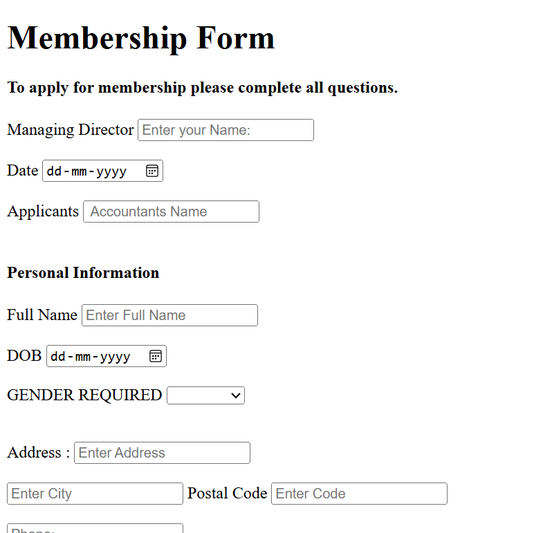

# 📝 Membership Application Form

## 📌 About the Project

The Membership Application Form is a simple web development project created using HTML and CSS. It allows users to enter their personal information, select a membership type, provide emergency contact details, and complete a membership application.

This project is designed to practice HTML forms, input fields, labels, dropdown menus, radio buttons, and basic CSS styling.

## ✨ Features

- 👤 Managing Director Information
- 📅 Application Date
- 🧑 Applicant Details
- 📋 Personal Information
- 🎂 Date of Birth
- ⚧ Gender Selection
- 🏠 Address and City Details
- 📞 Phone Number
- 📧 Email Address
- 🔐 Password Field
- 💳 Membership Type Selection
- 📆 Membership Start Date
- 🚨 Emergency Contact Information
- 📎 File Upload Field
- ✍️ Reason for Joining
- ✅ Membership Agreement
- 📤 Submit and Reset Buttons

## 🛠️ Technologies Used

- **HTML5** – To create the form structure and input fields.
- **CSS3** – To style and improve the appearance of the form.

## 📂 Project Structure

```text
Membership-Application-Form/
│
├── index.html
├── from.css
└── README.md
```

**Note:** If your HTML file has a different name, replace `index.html` with your actual filename.

## 🚀 How to Run the Project

1. Download or clone this repository.
2. Open the project folder in VS Code.
3. Make sure the HTML file and `from.css` are in the correct locations.
4. Open the HTML file in your web browser.
5. Fill in the form fields and explore the available options.

## 🎯 Learning Objectives

Through this project, I practiced:

- Creating HTML forms.
- Using different HTML input types.
- Connecting labels with input fields.
- Creating dropdown menus using `<select>` and `<option>`.
- Using radio buttons for membership selection.
- Adding date, email, telephone, and password fields.
- Using text areas for longer responses.
- Applying basic CSS styling to a form.
- Organizing project files for GitHub.

## 🔮 Future Improvements

- Add more advanced CSS styling.
- Improve the mobile-responsive layout.
- Add JavaScript form validation.
- Display a confirmation message after submission.
- Connect the form to a backend for storing applications.
- Improve accessibility and error handling.

## 👨‍💻 Author

**Raghav Gupta**

B.Tech Computer Science Student

## 📄 License

This project was created for educational and learning purposes.

---

⭐ Thank you for visiting my project!